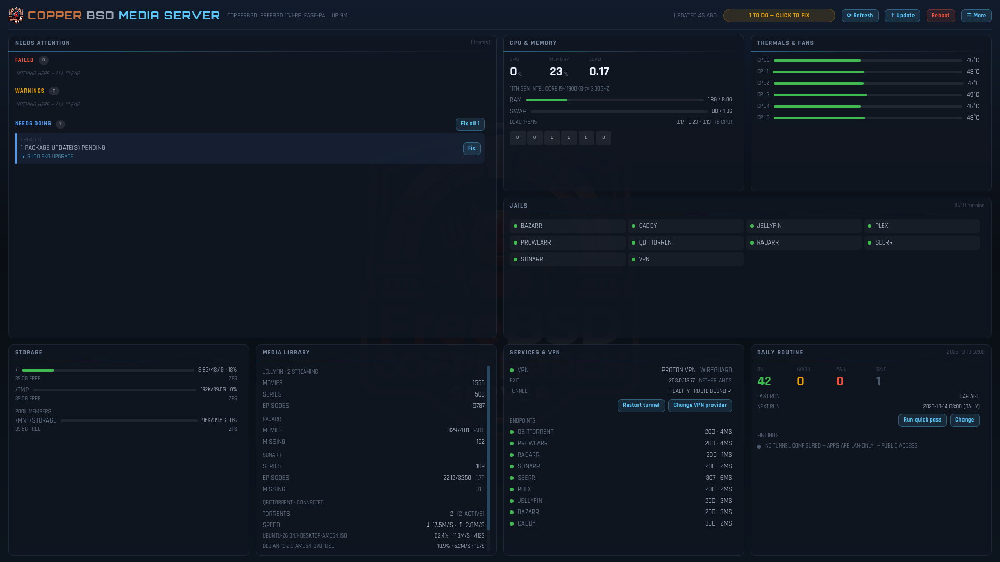
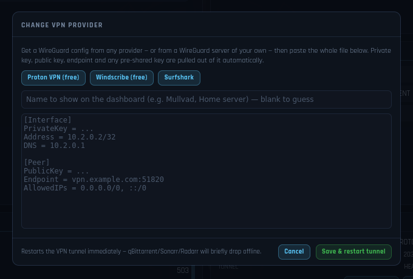
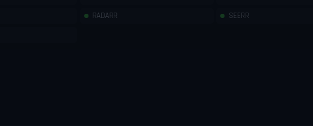
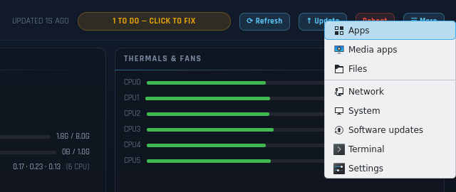

# CopperBSD

**A FreeBSD you install from a USB stick and end up with a working home
media server.** CopperBSD is FreeBSD 15.1 with a graphical installer, your
choice of desktop, and the CopperArch media server built in: streaming apps,
download apps behind a WireGuard VPN with a kill-switch, a native dashboard,
and a nightly routine that keeps the machine healthy.

**Download:** the latest ISO is on the
[releases page](https://github.com/CopperArch/CopperBSD/releases).
**Version:** see [`VERSION`](VERSION) · [changelog](CHANGELOG.md)



## What it does

1. **Boot the ISO** and a graphical installer starts. Pick a desktop, a disk
   and a user name.
2. **Reboot** into FreeBSD with that desktop.
3. **On first boot it sets up the media server by itself**: one jail per app,
   the VPN jail and kill-switch, the nightly routine, and the dashboard.
4. **Open the dashboard** to see everything, add your VPN, and fix problems
   with one click.

## Features

**The system**
- FreeBSD 15.1 on ZFS, delivered as a bootable live ISO (UEFI).
- A native Qt 6 graphical installer; no text menus.
- Five desktops to choose from: KDE Plasma, GNOME, XFCE, Niri and MangoWC.
- An **Update** button that fetches the latest CopperBSD from GitHub and
  applies it in place, keeping your media, settings and profile.

**Media and downloads**
- Jellyfin and Plex for streaming; Sonarr, Radarr and Prowlarr to find and
  organise films and series; Bazarr for subtitles; qBittorrent to download;
  Seerr for requests; Caddy as the reverse proxy.
- Each app runs in its own jail, installed from FreeBSD's own packages.
- A spare disk in the machine is never touched without you asking.

**VPN**
- Kernel WireGuard in a dedicated jail. Works with any provider that gives
  you a WireGuard config, or with a server of your own.
- The download apps are installed by default and stay **offline until you add
  a VPN** from the dashboard. If the tunnel ever drops, a pf kill-switch cuts
  them off; they never fall back to your real address.
- **Change VPN provider** by pasting a new `.conf` file.

**Dashboard** (a native app, not a web page)
- CPU, memory, swap, temperatures and disks, live every 2 seconds.
- Every jail, service, the VPN and the media library, refreshed every
  10 seconds.
- A **Needs attention** list with a **Fix** button next to each problem and a
  **Fix all**. Fixes come from a fixed whitelist.
- Refresh, Update and Reboot; a schedule dialog for the nightly run; an app
  launcher and System / Network pages under **More**.

**Self-healing**
- Nightly: ZFS pool and disk health, stopped jails and services, the VPN
  tunnel, package updates with a ZFS snapshot taken first, clean-up of old
  downloads and caches.

## Screenshots

**The dashboard**

| Changing VPN provider | Nightly schedule | More menu |
|---|---|---|
|  |  |  |

The dashboard screenshots were taken on FreeBSD 15.1 with the app fed
demonstration data: host name, addresses and downloads are made up.

**The installer**, running from the live ISO in a QEMU/KVM virtual machine
(UEFI, 2026-10-09).

| Welcome | Choose your desktop |
|---|---|
|  |  |

| Installation destination | Create your account |
|---|---|
|  |  |

## Related projects

- [freebsd-media-setup-with-dash](https://github.com/CopperArch/freebsd-media-setup-with-dash):
  the media server on its own, for an existing FreeBSD machine.
- [CopperArch-Linux-Media](https://github.com/CopperArch/CopperArch-Linux-Media):
  the same server on Linux, with Docker.

## How it is put together

CopperBSD is a fork of `freebsd-media-setup-with-dash`, restructured as a
distribution build. The media-server application under `project/` is a copy
of that project, refreshed with `tools/sync-project.sh` rather than edited
here; the few things CopperBSD does differently (its own dashboard, no
automatic pooling of spare disks) are in `project/lib/distro.py`.
`project/UPSTREAM` records the version the copy was taken from.

## Build it (one command, no FreeBSD host required)

```sh
./build.sh
```

- On a **FreeBSD** host it builds directly.
- On **Linux/macOS** it provisions an **ephemeral FreeBSD builder VM** (QEMU) and
  builds inside it — you do not set up FreeBSD yourself.
- With **no QEMU**, push to GitHub and run the **Build CopperBSD ISO** Action
  (`.github/workflows/build-iso.yml`): it provisions a FreeBSD VM and uploads the
  ISO artifact. Zero local setup.

Output: `build/output/CopperBSD-15.1-amd64.iso` (+ `.sha256`).

`FROM_SOURCE=1 ./build.sh` builds the base with `buildworld` from the pinned
source (faithful, slow). `FROM_SOURCE=0` (default in CI) uses the 15.1 release
sets — the **same pinned release**, much faster.

## Test it

```sh
./test.sh
```

Runs the host-agnostic static suite always; once an ISO exists it also runs ISO
structural validation and a QEMU boot test.

## What actually happens in the build

```
freebsd/ (pinned releng/15.1 @ e38a7085f3a8)
  → fetch full source at that commit
  → base system into a live root (buildworld | release sets)
  → pkg: KDE Plasma 6, Qt 6, Bastille, python, caddy, wireguard, ttyd …
  → build installer/frontend (Qt) → /usr/local/bin/copperbsd-installer
  → bake project/ → /usr/local/freebsd-media-setup  (installed system has it)
  → overlays/ → live autologin that autostarts the installer
  → /usr/freebsd-dist (base.txz/kernel.txz) for the installer to extract
  → mkisoimages.sh -b → bootable UEFI+BIOS live ISO
```

The installer (`installer/frontend`, Qt/QML) drives FreeBSD's own `bsdinstall`
subcommands (`installer/backend/copperarch-install.sh`) — verified against the
pinned source — so ZFS/partitioning is FreeBSD's, wrapped in a modern graphical
flow (Welcome · Language · Keyboard · Network · Disk · User · Summary · Install).
On first boot of the installed system, the project's desktop + media stack come
up automatically.

## The dashboard


`copper-dashboard` (native Qt 6/QML, `dashboard/`) has the same layout and
functions as the CopperArch Linux and FreeBSD dashboards — it is the same
design drawn natively instead of in a browser:

- **Header** — host, uptime, how fresh the data is, a verdict pill that
  repairs whatever is failing when clicked, and **Refresh / Update / Reboot**.
- **Panels** — Needs attention (with one-click fixes and "Fix all"), CPU &
  memory, Thermals & fans, Jails, Storage, Media library, Services & VPN,
  Daily routine. Four columns on a desktop, two or one in a narrow window.
- **Repairs** — the same closed whitelist the other editions use (start or
  restart a jail, restart the VPN group or tunnel, Prowlarr test-all,
  Cloudflare unblock, `pkg upgrade`, quick routine pass), with a live log
  and a two-click Cancel.
- **Services & VPN** names the VPN that is active. **Change VPN provider**
  takes a pasted WireGuard config from any provider *or from a WireGuard
  server of your own* (pre-shared keys included) and an optional name for it.
- **Update → Update CopperBSD** compares the installed version with the
  latest on GitHub and, when asked, downloads it, replaces the media-server
  project and the dashboard source, rebuilds the dashboard if it changed and
  re-applies the media stack with your saved profile
  (`/usr/local/libexec/copperbsd-update`; `--check` only looks).
- **More** keeps the app launcher and the local System / Network pages.

It talks over loopback HTTP to two pieces the media project installs: a
collector (`status-collect.py`, every 10 seconds; CPU, memory, swap and disks are read live every 2) and a root-run repair server
(`status-dashboard-server.py`, `127.0.0.1:8099`). Without the media stack
there is no data to show and the dashboard says so. The AI chat dock of the
Linux edition is not part of the native app.

**Tested how:** the dashboard has been compiled and run on a real FreeBSD
15.1 machine (a ZFS virtual machine with the full media stack installed), on
a virtual display: the panels, the narrow layouts, the dialogs, the repairs
and a real update from one version to the next. It has **not** been run on a
physical screen.

## Honest status (this was authored in a Linux sandbox)

Per the project's own rule: nothing below is claimed working unless it was run.

| Thing | Status | Evidence / reason |
|---|---|---|
| Static validation (shell/Python/YAML/CMake/overlay/installerconfig) | **TESTED, PASS** | `./test.sh` → 42 passed, 0 failed, here on Linux |
| Pinned FreeBSD source present + commit recorded | **TESTED** | `freebsd/src-pinned/` (release tooling, bsdinstall, rc) + `freebsd/COMMIT` |
| `bsdinstall` subcommand order / `installerconfig` / `mkisoimages.sh` args | **TESTED against real source** | checked against `freebsd/src-pinned` |
| Qt installer compiles | **NOT TESTED** | no Qt6/FreeBSD in the authoring sandbox; builds in the FreeBSD builder |
| ISO actually built | **NOT TESTED HERE** | authoring sandbox has no FreeBSD toolchain, no ISO tools, and FreeBSD mirrors are blocked by its proxy. Fully automated via `build.sh`/CI to run in the real builder |
| ISO boot-tested in a VM | **NOT TESTED HERE** | same reason; `tests/boot-test.sh` runs it in the builder/CI |

**Update, 2026-10-09.** The table above describes the original authoring
sandbox. Since then an ISO has been built (`CopperBSD-15.1-amd64.iso`, SHA256
`46576a86c7abc1800701f00cca70c48d492b0901684d626100df9c8f39401fde`) and booted
in QEMU/KVM with UEFI firmware: it reaches the graphical installer, which was
stepped through from Welcome to the account page (screenshots above). A full
install to disk and the installed system's first boot were **not** run in that
session. `./test.sh` gives 49 passed, 1 failed in this checkout — the failing
check is the vendored `freebsd/src-pinned/` subset, which is not included here
(the build fetches the source at the pinned commit).

**Update, 2026-10-12 — the installed system, run for real.** Everything below
was run on FreeBSD 15.1-RELEASE (ZFS root, QEMU/KVM), staged the way the
installer stages it and driven by the real `copperbsd_firstboot` functions:

| Thing | Result |
|---|---|
| First-boot media install, from a pristine system | every step OK: host packages, Bastille, jail NAT, `zroot/media`, six media jails, Seerr built from source, VPN jail + qBittorrent/Sonarr/Radarr, nightly routine, dashboard backend |
| Every app answers on its jail address | Jellyfin, Plex, Prowlarr, Bazarr, Seerr, Caddy, qBittorrent, Sonarr, Radarr |
| A second disk in the machine | left untouched |
| No VPN config yet | the three download jails have no internet access at all |
| VPN added through the dashboard's API (WireGuard, with a pre-shared key) | tunnel up; the download jails reach the internet through it, including name lookups and a 9 MB download |
| Tunnel taken down | the download jails are cut off again; everything else stays online |
| Reboot | all ten jails, both firewall layers and the tunnel come back by themselves |
| Installer run again | converges without rebuilding Seerr or dropping the kill-switch; repairs jails an interrupted run left without their packages |
| Nightly routine, full pass | 42 OK, 0 warnings, 0 failures; pre-upgrade snapshots taken |
| Native dashboard | compiles and installs; on a virtual display it shows the live system as "all systems OK"; restart-a-jail, restart-the-tunnel, change-schedule and update-check all work through it |
| `./test.sh` static checks | 62 passed, 0 failed |

Not run: the graphical installer writing to a disk, the desktop download, the
dashboard on a real screen, a real commercial VPN provider (the test used a
WireGuard server of its own), Nextcloud, and public access.

## §18 acceptance report

1. **FreeBSD source commit:** `e38a7085f3a8ecd317c947591fe42b5ca9ab317b` (`releng/15.1`, GitHub mirror; `git.FreeBSD.org` is proxy-blocked here — see `freebsd/SOURCE.md`).
2. **Project parts incorporated:** the whole media server (`lib/`, `templates/`, `stacks/`, `vpn/`, `profiles/`, `install.py`, `rebuild`) → baked to `/usr/local/freebsd-media-setup`; dashboard, Nextcloud, VPN/pf, self-heal all included.
3. **Installer created:** native Qt 6/QML graphical installer (`installer/frontend`) + a `bsdinstall`-driving backend (`installer/backend`).
4. **How it integrates with FreeBSD:** the GUI collects answers and runs real `bsdinstall zfsboot/mount/distextract/bootconfig/config` + a chroot post-install; no partitioning is reimplemented.
5. **Build command:** `./build.sh`
6. **Test command:** `./test.sh`
7. **ISO actually produced?** **NO — not in this authoring sandbox** (no FreeBSD/ISO tooling, mirrors blocked). It is produced by `./build.sh` on a FreeBSD host, the QEMU builder, or CI.
8. **ISO filename:** `build/output/CopperBSD-15.1-amd64.iso`
9. **ISO checksum:** **none yet** — would be fabricated to state one; `.sha256` is emitted by the build.
10. **ISO boot-tested?** **NO, not here.** `tests/boot-test.sh` performs it in the builder/CI.
11. **Full install tested?** **NO, not here.** Same harness covers it where QEMU exists.
12. **Unfinished:** running an actual build+boot requires executing `build.sh` in a FreeBSD-capable environment (CI is the zero-setup path). Everything needed to do so is in this repo.

## Structure

```
CopperBSD/
├── freebsd/            pinned FreeBSD 15.1 source subset + COMMIT + SOURCE.md
├── project/            the media-server application (synced from upstream)
├── tools/              sync-project.sh (refresh project/ from upstream)
├── installer/
│   ├── frontend/       Qt 6/QML graphical installer
│   ├── backend/        bsdinstall-driving install driver
│   └── configuration/  installerconfig + firstboot
├── overlays/           live-ISO files (autologin → installer, live markers)
├── release/            release.conf (stock release.sh path, optional)
├── build/              config.sh, fetch-src.sh, in-vm-build.sh, freebsd-builder.sh
├── tests/              static-checks.sh, iso-validate.sh, boot-test.sh
├── build.sh  test.sh   one-command build / test
└── ARCHITECTURE.md     component-by-component origin + Linux-ism audit
```

See `build/MANIFEST.md` for full traceability (what differs from upstream 15.1).
