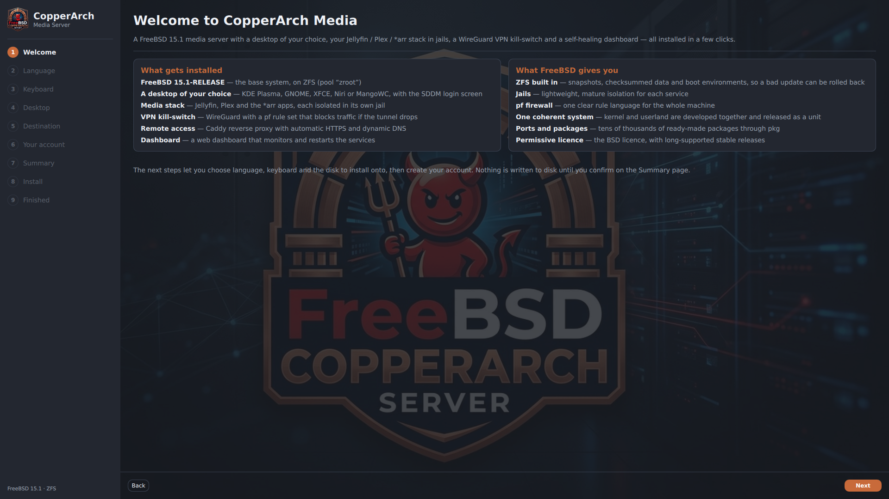
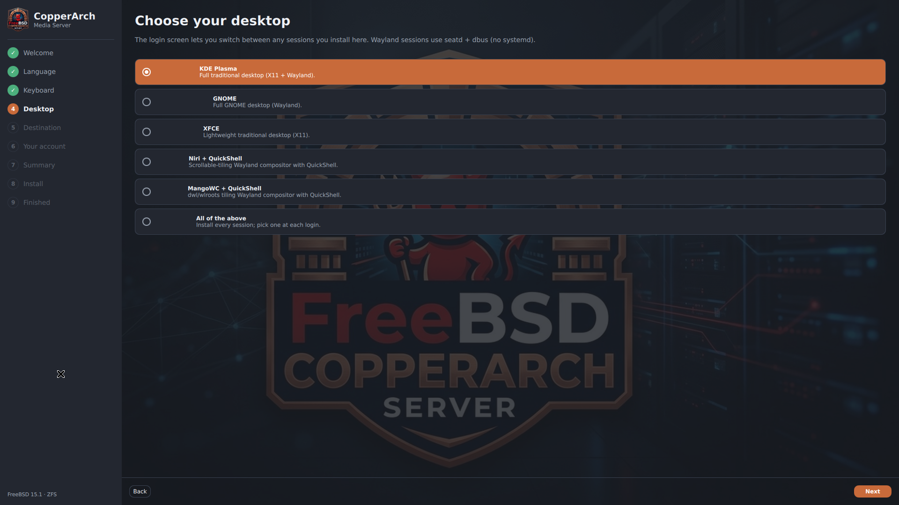
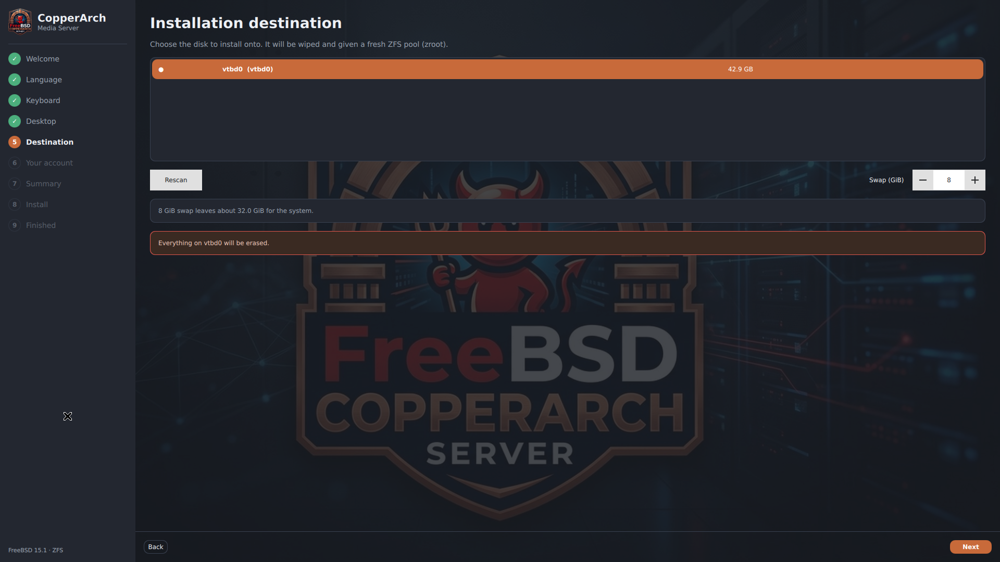
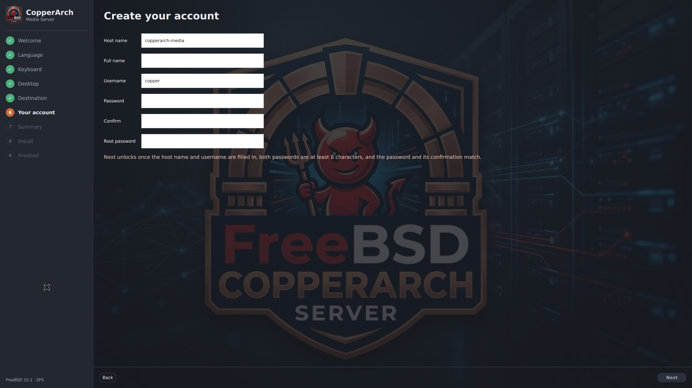

# CopperBSD

A custom operating-system distribution: **FreeBSD 15.1 + the CopperArch media
server + a native graphical installer, built as one thing** and delivered as a
bootable live ISO. Boot the ISO → graphical installer → reboot → a FreeBSD
system that already contains the project, running.

This is a fork of `freebsd-media-setup-with-dash`, restructured as a distribution
build. The media-server application is reused unchanged under `project/`.

**Version:** see [`VERSION`](VERSION) · [changelog](CHANGELOG.md)

## Screenshots

The graphical installer, running from the live ISO in a QEMU/KVM virtual
machine (UEFI, 2026-10-09).

| Welcome | Choose your desktop |
|---|---|
|  |  |

| Installation destination | Create your account |
|---|---|
|  |  |

## Build it (one command, no FreeBSD host required)

```sh
./build.sh
```

- On a **FreeBSD** host it builds directly.
- On **Linux/macOS** it provisions an **ephemeral FreeBSD builder VM** (QEMU) and
  builds inside it — you do not set up FreeBSD yourself.
- With **no QEMU**, push to GitHub and run the **Build CopperBSD ISO** Action
  (`.github/workflows/build-iso.yml`): it provisions a FreeBSD VM and uploads the
  ISO artifact. Zero local setup.

Output: `build/output/CopperBSD-15.1-amd64.iso` (+ `.sha256`).

`FROM_SOURCE=1 ./build.sh` builds the base with `buildworld` from the pinned
source (faithful, slow). `FROM_SOURCE=0` (default in CI) uses the 15.1 release
sets — the **same pinned release**, much faster.

## Test it

```sh
./test.sh
```

Runs the host-agnostic static suite always; once an ISO exists it also runs ISO
structural validation and a QEMU boot test.

## What actually happens in the build

```
freebsd/ (pinned releng/15.1 @ e38a7085f3a8)
  → fetch full source at that commit
  → base system into a live root (buildworld | release sets)
  → pkg: KDE Plasma 6, Qt 6, Bastille, python, caddy, wireguard, ttyd …
  → build installer/frontend (Qt) → /usr/local/bin/copperbsd-installer
  → bake project/ → /usr/local/freebsd-media-setup  (installed system has it)
  → overlays/ → live autologin that autostarts the installer
  → /usr/freebsd-dist (base.txz/kernel.txz) for the installer to extract
  → mkisoimages.sh -b → bootable UEFI+BIOS live ISO
```

The installer (`installer/frontend`, Qt/QML) drives FreeBSD's own `bsdinstall`
subcommands (`installer/backend/copperarch-install.sh`) — verified against the
pinned source — so ZFS/partitioning is FreeBSD's, wrapped in a modern graphical
flow (Welcome · Language · Keyboard · Network · Disk · User · Summary · Install).
On first boot of the installed system, the project's desktop + media stack come
up automatically.

## Honest status (this was authored in a Linux sandbox)

Per the project's own rule: nothing below is claimed working unless it was run.

| Thing | Status | Evidence / reason |
|---|---|---|
| Static validation (shell/Python/YAML/CMake/overlay/installerconfig) | **TESTED, PASS** | `./test.sh` → 42 passed, 0 failed, here on Linux |
| Pinned FreeBSD source present + commit recorded | **TESTED** | `freebsd/src-pinned/` (release tooling, bsdinstall, rc) + `freebsd/COMMIT` |
| `bsdinstall` subcommand order / `installerconfig` / `mkisoimages.sh` args | **TESTED against real source** | checked against `freebsd/src-pinned` |
| Qt installer compiles | **NOT TESTED** | no Qt6/FreeBSD in the authoring sandbox; builds in the FreeBSD builder |
| ISO actually built | **NOT TESTED HERE** | authoring sandbox has no FreeBSD toolchain, no ISO tools, and FreeBSD mirrors are blocked by its proxy. Fully automated via `build.sh`/CI to run in the real builder |
| ISO boot-tested in a VM | **NOT TESTED HERE** | same reason; `tests/boot-test.sh` runs it in the builder/CI |

**Update, 2026-10-09.** The table above describes the original authoring
sandbox. Since then an ISO has been built (`CopperBSD-15.1-amd64.iso`, SHA256
`46576a86c7abc1800701f00cca70c48d492b0901684d626100df9c8f39401fde`) and booted
in QEMU/KVM with UEFI firmware: it reaches the graphical installer, which was
stepped through from Welcome to the account page (screenshots above). A full
install to disk and the installed system's first boot were **not** run in that
session. `./test.sh` gives 49 passed, 1 failed in this checkout — the failing
check is the vendored `freebsd/src-pinned/` subset, which is not included here
(the build fetches the source at the pinned commit).

## §18 acceptance report

1. **FreeBSD source commit:** `e38a7085f3a8ecd317c947591fe42b5ca9ab317b` (`releng/15.1`, GitHub mirror; `git.FreeBSD.org` is proxy-blocked here — see `freebsd/SOURCE.md`).
2. **Project parts incorporated:** the whole media server (`lib/`, `templates/`, `stacks/`, `vpn/`, `profiles/`, `install.py`, `rebuild`) → baked to `/usr/local/freebsd-media-setup`; dashboard, Nextcloud, VPN/pf, self-heal all included.
3. **Installer created:** native Qt 6/QML graphical installer (`installer/frontend`) + a `bsdinstall`-driving backend (`installer/backend`).
4. **How it integrates with FreeBSD:** the GUI collects answers and runs real `bsdinstall zfsboot/mount/distextract/bootconfig/config` + a chroot post-install; no partitioning is reimplemented.
5. **Build command:** `./build.sh`
6. **Test command:** `./test.sh`
7. **ISO actually produced?** **NO — not in this authoring sandbox** (no FreeBSD/ISO tooling, mirrors blocked). It is produced by `./build.sh` on a FreeBSD host, the QEMU builder, or CI.
8. **ISO filename:** `build/output/CopperBSD-15.1-amd64.iso`
9. **ISO checksum:** **none yet** — would be fabricated to state one; `.sha256` is emitted by the build.
10. **ISO boot-tested?** **NO, not here.** `tests/boot-test.sh` performs it in the builder/CI.
11. **Full install tested?** **NO, not here.** Same harness covers it where QEMU exists.
12. **Unfinished:** running an actual build+boot requires executing `build.sh` in a FreeBSD-capable environment (CI is the zero-setup path). Everything needed to do so is in this repo.

## Structure

```
CopperBSD/
├── freebsd/            pinned FreeBSD 15.1 source subset + COMMIT + SOURCE.md
├── project/            the media-server application (reused unchanged)
├── installer/
│   ├── frontend/       Qt 6/QML graphical installer
│   ├── backend/        bsdinstall-driving install driver
│   └── configuration/  installerconfig + firstboot
├── overlays/           live-ISO files (autologin → installer, live markers)
├── release/            release.conf (stock release.sh path, optional)
├── build/              config.sh, fetch-src.sh, in-vm-build.sh, freebsd-builder.sh
├── tests/              static-checks.sh, iso-validate.sh, boot-test.sh
├── build.sh  test.sh   one-command build / test
└── ARCHITECTURE.md     component-by-component origin + Linux-ism audit
```

See `build/MANIFEST.md` for full traceability (what differs from upstream 15.1).
